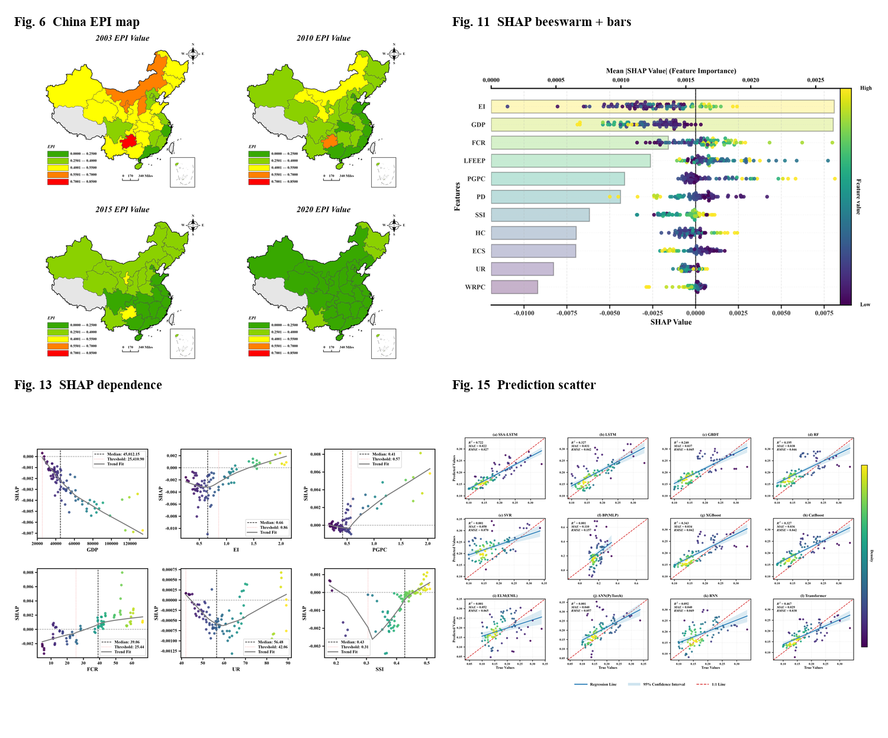

# yile-paper-style

王毅乐论文的**语言风格 + 制图风格** skill。默认面向英文实证论文（经济学 + 机器学习 + 空间分析），覆盖 Systems、Scientific Reports、Sustainability、Frontiers 四种版面。

**公开仓库**：[KarlHeinrich-jpg/yile-paper-style](https://github.com/KarlHeinrich-jpg/yile-paper-style)



## 安装位置

```
~/.agents/skills/yile-paper-style/
```

ZCode 会自动发现 `~/.agents/skills/<name>/SKILL.md`。在对话里说“按我论文风格画图 / 中国地图 / SHAP 图 / 复刻论文插图 / 论文润色”即可触发。

## 一键预览

```bash
cd ~/.agents/skills/yile-paper-style
python scripts/build_examples.py
```

生成：

- [fig06_china_epi_4panel.png](assets/previews/fig06_china_epi_4panel.png) — 中国 EPI 四级地图（含台湾省级面）
- [fig11_shap_combo.png](assets/previews/fig11_shap_combo.png) — SHAP 蜂群 + 条形
- [fig13_shap_dependence.png](assets/previews/fig13_shap_dependence.png) — SHAP 依赖图 2×3
- [fig15_prediction_scatter.png](assets/previews/fig15_prediction_scatter.png) — 12 模型预测散点
- [_contact_sheet.png](assets/previews/_contact_sheet.png) — 四图总览

## 目录

```
SKILL.md                     # 触发与工作流
references/
  writing-style.md           # 语言风格、章节模板、句式库、自检
  figure-style.md            # 制图规格、颜色、地图/SHAP/散点细节
  figure-catalog.md          # 五篇论文插图清单与模板映射
  journal-profiles.md        # MDPI / Nature / Frontiers 格式差异
scripts/
  paper_style.py             # rcParams、palette、保存
  china_map.py               # 中国省级地图
  shap_plots.py              # SHAP 组合、网格、依赖图
  pred_scatter.py            # 多模型预测散点
  style_lint.py              # 语言风格体检
  build_examples.py          # 一键重生成预览
assets/
  geo/                       # 中国省界 + 台湾省多边形
  data/                      # 本地示例数据（公开仓库不包含；见 data/README.md）
  previews/                  # 四张复刻图
```

## 边界

- 只读原始 PDF、ZIP、GitHub 仓库；输出写到 `output/` 或用户指定目录。
- 不覆盖原图，不修改任何 GitHub 仓库。
- 示例数据仅用于复刻版式；正式论文请接真实数据。
- 中国地图的南海小图与九段线是完整性元素；正式投稿请用官方边界文件替换示意线。
- 台湾作为省级面并入地图；无数据时浅灰显示，不加文字标注。
- 公开 GitHub 仓库不包含作者的 EPI、SHAP、模型预测示例数据；`assets/data/README.md` 给出数据契约。
